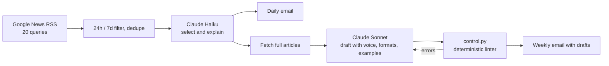

# AI Industry Brief


Two scheduled LLM pipelines on GitHub Actions turn industry news into material for the business owner. They need no servers and cost cents per run.

- **Daily brief** (`resumen.py`, weekdays at 7:00 Buenos Aires time):
  1. Collects headlines from 20 Google News RSS queries about the clients' industry (distributors, wholesalers, importers and manufacturers that sell to retailers).
  2. Keeps only the last 24 hours, or since Friday when it runs on a Monday.
  3. Makes one Claude Haiku call that picks up to 7 stories and explains what each one means for a distributor.
  4. Emails the result.

  It works from headlines only, so the model has no room to invent figures.
- **Weekly content batch** (`contenido.py`, Mondays):
  1. Haiku picks the 6 stories of the week with the most material.
  2. The script downloads each full article, so the numbers come from the source and not from the headline.
  3. Sonnet drafts 2 reel scripts, 2 carousels, 3 LinkedIn posts and 5 X posts. It follows a voice guide (`VOZ.md`), platform formats (`MOLDES.md`) and approved examples (`EJEMPLOS.md`).
  4. Every draft goes through `control.py`, a deterministic linter for the brand's writing rules: sentence length, banned words, superlatives, punctuation and promises. If it finds errors, Sonnet rewrites that piece once.
  5. The drafts arrive by email for a human to choose. Nothing is published automatically.

Each run logs its tokens and its exact cost. The daily brief costs under USD 0.01 a day.

I built it for my growth agency's content and sales team. The output is in Rioplatense Spanish, so the prompts and the guides are in Spanish too.

## Pattern



## Setup

Add these repository secrets: `ANTHROPIC_API_KEY`, `GMAIL_USER`, `GMAIL_APP_PASSWORD` and `MAIL_TO`. The workflows in `.github/workflows/` run on their own schedule, or by hand from the Actions tab.

To run it locally:

```bash
pip install -r requirements.txt
python resumen.py
python contenido.py --sin-mail   # everything except sending; prints the email
python contenido.py --seco       # only selects and fetches articles
```

Shared for portfolio review. All rights reserved.
